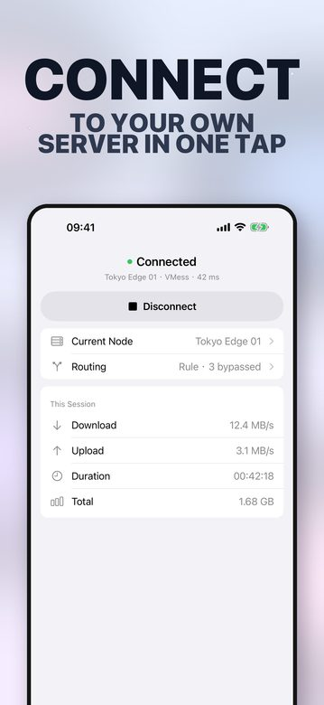
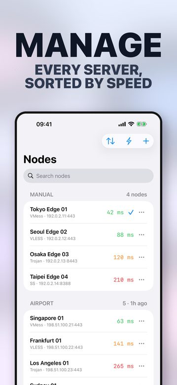
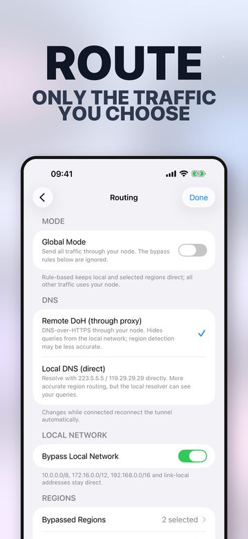
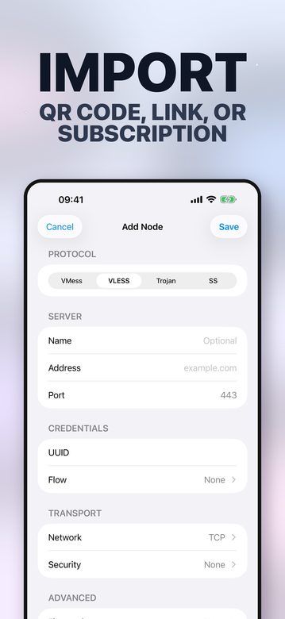
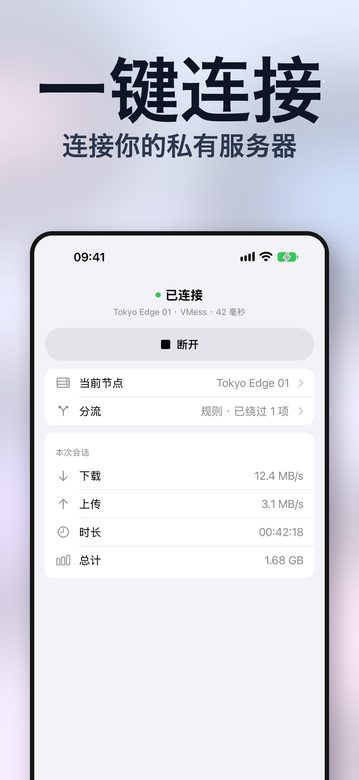
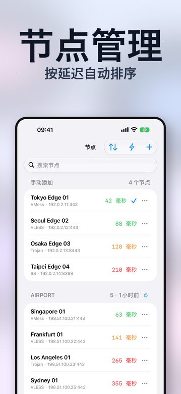
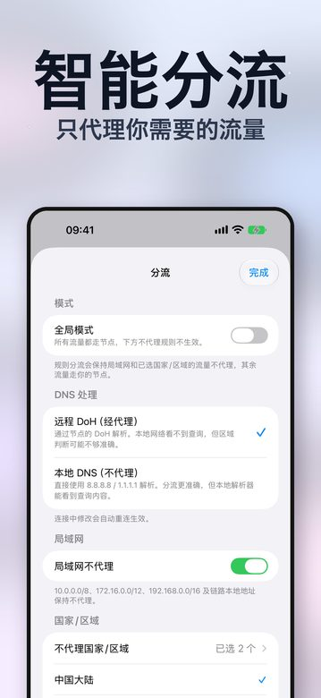
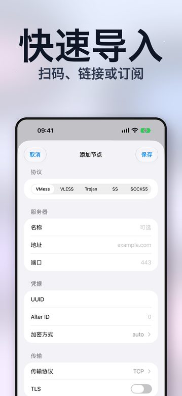

<div align="center">
  
  <h1>WProxy · 无极代理</h1>
  <p><strong>A native iOS &amp; iPadOS client for your own proxy server.</strong><br>
  连接你自己服务器的原生 iOS / iPadOS 代理客户端。</p>

  <a href="https://apps.apple.com/cn/app/%E6%97%A0%E6%9E%81%E4%BB%A3%E7%90%86/id1448657437">
    
 
   [App Store (Global)](https://apps.apple.com/app/id1448657437)
 

  <p><strong>✅ 已上架 App Store · Now available on the App Store</strong></p>
</div>

---

## English

### What WProxy is

WProxy is a **bring-your-own-server** proxy client for iPhone and iPad. It does not sell nodes, run a proxy service, require an account, show ads, or offer in-app purchases.

You add your own VMess, VLESS, Trojan, Shadowsocks, or SOCKS5 server by pasting a link, scanning a QR code, or importing a subscription. WProxy handles the local configuration, routing, DNS, latency tests, and the system VPN tunnel.

### Features

- **Protocols**: VMess, VLESS, Trojan, Shadowsocks, SOCKS5
- **Import**: paste a share link, scan a QR code, or add a subscription
- **Latency testing**: automatic test after adding a node/importing or refreshing a subscription, plus manual tests
- **Routing**: global mode or rule-based split routing, with bypassed countries/regions and LAN bypass
- **DNS**: remote DoH for proxied domains, direct resolution for bypassed/CN domains, or local DNS mode
- **Languages**: English, 简体中文, 繁體中文, Español, Français, Deutsch, 日本語, 한국어, Русский, ไทย, Tiếng Việt
- **Devices**: iPhone and iPad, iOS / iPadOS 17+
- **Privacy by design**: no account, analytics, ads, or tracking; nodes and settings stay on your device

### Screenshots

<p align="center">
  
  
  
  
</p>

### Install

Download WProxy from the App Store:

- [App Store (China mainland)](https://apps.apple.com/cn/app/%E6%97%A0%E6%9E%81%E4%BB%A3%E7%90%86/id1448657437)
- [App Store (Global)](https://apps.apple.com/app/id1448657437)

### Build from source

Requirements: macOS with Xcode (iOS 17+ SDK), [XcodeGen](https://github.com/yonaskolb/XcodeGen), and an Apple Developer team for the Network Extension entitlement.

```bash
git clone git@github.com:ji4ozhu-wq/wproxy.git
cd wproxy
xcodegen generate
open Wuji.xcodeproj
```

Select the `Wuji` scheme, set your signing team for both `Wuji` and `WujiTunnel`, then run on an iPhone or iPad. The repository includes `Frameworks/LibXray.xcframework`; the app uses Xray-core via LibXray.

- Minimum deployment target: iOS 17.0
- App Group: `group.com.youqu.wuji.appgroup`
- Network Extension bundle: `com.juejin.ios.wuji.tunnel-ext`
- App bundle: `com.juejin.ios.wuji`

### Privacy

WProxy does not collect, sell, or share personal data. Nodes, subscriptions, settings, and traffic counters are stored locally. Traffic goes to the server you configure, not to us. The app includes no advertising, analytics, or third-party tracking SDKs.

Read the full documents:

- [Privacy Policy](https://www.54nb.com/privacy.html)
- [Terms of Use](https://www.54nb.com/terms.html)
- [Support](https://www.54nb.com/support.html)

### License

This repository is licensed under the [Apache License 2.0](LICENSE).

Third-party components:

- **Xray-core** — Mozilla Public License 2.0
- **libXray** — MIT License
- **Country routing data** — derived from DB-IP Lite (CC BY 4.0) via the v2fly/geoip project (CC BY-SA 4.0)

### Disclaimer

WProxy is a client only. You must provide and operate your own server or use a subscription you are authorized to use. You are responsible for complying with the laws and regulations that apply to you and for the security of your server and credentials. Apple, App Store, iPhone, and iPad are trademarks of Apple Inc.

---

## 简体中文

### 无极代理是什么

无极代理（WProxy）是一款 **自带服务器（BYO Server）** 的 iPhone / iPad 代理客户端。我们不销售节点、不运营代理服务、不要求注册账号，也没有广告或内购。

你可以通过粘贴链接、扫码或导入订阅，添加自己的 VMess、VLESS、Trojan、Shadowsocks 或 SOCKS5 服务器；App 负责本地配置、分流、DNS、测速和系统 VPN 隧道。

### 功能

- **协议**：VMess、VLESS、Trojan、Shadowsocks、SOCKS5
- **导入**：粘贴分享链接、扫描二维码、添加订阅
- **测速**：手动添加 / 导入 / 刷新订阅后自动测速，也支持手动测试
- **分流**：全局模式或规则分流，可设置绕行国家/区域、局域网不代理
- **DNS**：远程 DoH、绕过/国内域名直连解析，或本地 DNS 模式
- **语言**：English、简体中文、繁體中文、Español、Français、Deutsch、日本語、한국어、Русский、ไทย、Tiếng Việt
- **设备**：iPhone 和 iPad，iOS / iPadOS 17+
- **隐私**：无账号、无分析、无广告、无追踪；节点和设置只保存在本机

### 截图

<p align="center">
  
  
  
  
</p>

### 下载

已上架 App Store：

- [App Store（全球）](https://apps.apple.com/app/id1448657437)

### 从源码构建

环境要求：macOS + Xcode（iOS 17+ SDK）、[XcodeGen](https://github.com/yonaskolb/XcodeGen)，以及用于 Network Extension 的 Apple Developer Team。

```bash
git clone git@github.com:ji4ozhu-wq/wproxy.git
cd wproxy
xcodegen generate
open Wuji.xcodeproj
```

选择 `Wuji` scheme，为 `Wuji` 和 `WujiTunnel` 设置签名 Team，然后在 iPhone 或 iPad 上运行。仓库已包含 `Frameworks/LibXray.xcframework`，App 通过 LibXray 使用 Xray-core。

- 最低系统：iOS 17.0
- App Group：`group.com.youqu.wuji.appgroup`
- 网络扩展 Bundle：`com.juejin.ios.wuji.tunnel-ext`
- App Bundle：`com.juejin.ios.wuji`

### 隐私

无极代理不收集、出售或共享个人数据。节点、订阅、设置和流量统计都保存在本机；流量发送到你配置的服务器，不经过我们。App 不包含广告、分析或第三方追踪 SDK。

完整协议：

- [隐私政策](https://www.54nb.com/privacy.html)
- [用户协议](https://www.54nb.com/terms.html)
- [支持](https://www.54nb.com/support.html)

### 许可证

本仓库使用 [Apache License 2.0](LICENSE)。

第三方组件：

- **Xray-core** — Mozilla Public License 2.0
- **libXray** — MIT License
- **国家分流数据** — 来自 v2fly/geoip 项目，基于 DB-IP Lite（CC BY 4.0），以 CC BY-SA 4.0 分发

### 免责声明

无极代理仅为客户端。你需要自行提供并运营服务器，或使用你有权使用的订阅。请遵守你所在国家/地区的法律法规，并自行保护服务器与凭据安全。Apple、App Store、iPhone、iPad 是 Apple Inc. 的商标。

---

<div align="center">
  <sub>© 2026 绍兴天穹网络科技有限公司 · WProxy / 无极代理</sub>
</div>
