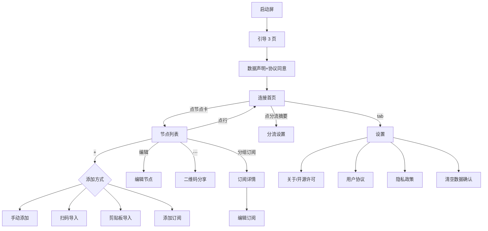

# 无极 Wuji — 需求文档（app-spec）

> 模式：共创（用户思路 + 旧 App 重构）；产物平台：iOS
> 文档结构沿用 `docs/recon-to-spec.md` §5 七段式。
> 功能来源：`docs/discussion.md` §2 决策记录、§3 功能清单（2026-11-20 用户确认）。本 spec 只包含清单中「确认做」的功能。
> 状态：阶段 1 产出；「三、画风/视觉」待阶段 2 用户确认后回填。

---

## 一、项目概述与技术栈

### 1.1 产品定位

**Wuji（中文名：无极代理）** 是一款 iOS 上的通用代理 / VPN 客户端。用户把自己已有的 Xray / v2ray 节点（或订阅）导入 App，通过系统 VPN 隧道统一转发流量；可以把局域网流量与用户勾选的国家的 IP 流量直连，其余走代理。**不提供节点、不做账号体系、不卖流量**——App 本身为付费下载（一次购买，无内购）。

### 1.2 目标用户

- 已有自建节点或机场订阅、需要一个好用 iOS 客户端的人。
- 旧「无极代理」的老用户（升级后看到全新版本；旧会员体系在新版不再出现）。
- 需要跨 iPhone / iPad / iPhone Duo 一致体验的用户。

### 1.3 核心功能一句话清单

1. 手动填写 / 扫码 / 相册识别 / 剪贴板 / 订阅链接导入节点（VMess、VLESS、Trojan、Shadowsocks）。
2. 一键连接 / 断开系统 VPN 隧道（Xray-core 内核），首页显示状态、节点、延迟、实时流量、连接时长。
3. 节点列表：分组、搜索、排序、测速、编辑、删除、复制 URI、二维码分享。
4. 订阅：添加、手动/自动更新、流量与到期信息、删除。
5. 节点协议：VMess / VLESS / Trojan / Shadowsocks / **SOCKS5**（用户名密码可选）。
6. 分流：全局模式单开关（规则分流 / 全部走代理）；局域网不代理开关；国家/地区不代理多选（按 IP 查 GeoIP 数据集判断）。
6. 按需连接（总是 / 仅 Wi-Fi / 仅蜂窝）。
7. 双语（zh-Hans / en，跟随系统），iPhone SE / iPhone Duo 折叠展开 / iPad 自适应。
8. 首次引导、数据声明与协议同意、关于与开源许可。

### 1.4 参考与来源

- **需求来源：共创**（用户思路原文见 `docs/discussion.md` §1）。
- **旧版参考**：自有 App「无极代理」，App Store CN `id1448657437`，Bundle ID `com.juejin.ios.wuji`（仅作业务与信息架构参考；旧 UI 全部重做，旧功能（账号/会员/换 IP/流量/续费）不再保留）。
- 视觉与技术栈均为重设计，不复用旧 App 素材。

### 1.5 产物平台与技术栈

| 项 | 选择 |
|---|---|
| 平台 | iOS 17.0+ / iPadOS 17.0+（iPhone、iPad、iPhone Duo 折叠形态自适应） |
| 语言 / UI | Swift 5.9+、SwiftUI（原生优先） |
| 工程 | XcodeGen（`project.yml`）生成 `Wuji.xcodeproj`，Xcode 27.2 |
| 主 App | `com.juejin.ios.wuji`（沿用旧 App Store 记录） |
| NE 扩展 | `com.juejin.ios.wuji.tunnel-ext`（NEPacketTunnelProvider） |
| App Group | `group.com.juejin.ios.wuji` |
| 内核 | **Xray-core**，通过 `XTLS/libXray`（MIT）构建 `LibXray.xcframework`；本地 fork 可加统计方法（见 §6.4） |
| 数据存储 | SQLite（原生 `libsqlite3` + 轻量 Swift 封装；不用 Core Data/UserDefaults） |
| 本地化 | String Catalog（`Localizable.xcstrings`），en + zh-Hans，回退 en |
| 商业模式 | 付费下载（无 StoreKit 代码）；旧内购商品在 App Store Connect 保留、新版不接入 |
| 分发 | 中国区 + 海外 App Store |
| 最低系统 | iOS / iPadOS 17.0 |
| 主题 | 单一浅色主题（不做深色模式），阶段 2 定稿 |

### 1.6 非目标（明确不做）

账号/登录、会员/剩余天数/换 IP/流量配额/续费、内购与恢复购买、自定义域名/IP 分流规则、配置导入/导出备份、日志页、评论/UGC、推送通知、深色模式、App 内广告、网页版。

---

## 二、全局交互与约束

### 2.1 语言与文案

- 所有用户可见文本走 `.strings` 表（Localizable / Nodes / Settings / Routing / Subscriptions / InfoPlist），键名语义化；11 种语言全套。
- 支持 11 种界面语言：`en` English、`zh-Hans` 简体中文、`zh-Hant` 繁體中文、`es` Español、`fr` Français、`de` Deutsch、`ja` 日本語、`ko` 한국어、`ru` Русский、`th` ไทย、`vi` Tiếng Việt。默认跟随系统；系统语言不在列表内时回退英文。
- **应用内语言菜单（2026-11-20 用户要求）**：设置 → 语言区显示两行：①「跟随系统」（勾选表示当前模式）；②「语言」行显示当前语言（跟随系统时显示解析后的系统语言），点击进入**二级菜单「选择其他语言」**，列出 11 种语言（母语名 + 英文名 + 勾选），选择后即时切换并持久化。
  - 切换即时生效：`L10n` 按所选 `.lproj` 取文案，根视图以 `.id(appLanguage)` 重建并同步 `.environment(\.locale)`，日期/数字随所选语言。
  - 选择写入设置（`AppSettings.appLanguage`，SQLite 持久化），重启保持；旧版设置 JSON 无该键时按「跟随系统」处理且不丢既有字段。
  - 应用内协议页（用户协议 / 隐私政策）只维护英文与简体中文；`zh-Hans` 打开中文版，其余语言打开英文版。
  - **App 名称**：`zh-Hans` = 无极代理、`zh-Hant` = 無極代理、其他 9 种语言 = WProxy；About 头部用 `L10n app.name`，InfoPlist 的 `CFBundleDisplayName` / `CFBundleName` 同步本地化。
  - **已知限制**：InfoPlist 权限用途弹窗（相机/相册/VPN）与主屏幕 App 名称由系统语言决定，运行时切换语言不会改变；主 App 显示名按系统语言本地化。
- 英文文案需自然（阶段 3 过 humanizer）；中文文案不得机翻腔。
- 权限用途文案（相机、相册）同样双语，写清实际用途。

### 2.1.1 首次启动权限

- 顺序：Onboarding 3 页 → **网络权限页** → 协议同意 → 主页。
- 网络权限页依次请求：① 本地网络（NWBrowser Bonjour 探测触发系统弹窗）；② VPN 配置（首次保存 NETunnelProviderManager 触发系统弹窗）。
- 两个权限都通过后写 `AppSettings.networkPermissionPassed=true` 并进入协议页；失败则停留在失败页，提供「重新请求」「打开系统设置」两个按钮，并阻止进入协议/主页。
- 已知限制：iOS 没有通用「联网授权」；本地网络与 VPN 配置是仅有的可主动请求项。模拟器无这两项弹窗，DEBUG 下模拟通过；`-WujiForcePermissionGate` / `-WujiForcePermissionFailure` 用于测试失败页。

### 2.2 导航

- 主框架：底部 3 个 tab —— **连接（Home）/ 节点（Nodes）/ 设置（Settings）**。
- 二级页面（节点详情编辑、添加节点、扫码、订阅详情、订阅编辑、分流设置、关于、开源许可、用户协议、隐私政策、二维码分享）隐藏底部 tab，用平台标准导航栈（`NavigationStack`）push，支持左缘右滑返回。
- 弹窗统一自定义风格（跟随本项目视觉），不用系统默认 Alert 样式（系统权限弹窗除外）。
- 破坏性操作（删除节点/订阅、清空数据、重置 VPN 配置）二次确认。
- iPad / iPhone Duo 展开宽度 ≥ 700pt 时：Home 与 Nodes 采用两栏（列表 + 详情）自适应；窄屏（SE/外屏）为单列 push。
- 关闭键盘：点击空白、下滑、回车/完成按钮。

### 2.3 通用状态

- **加载**：订阅拉取、测速、连接切换等耗时操作显示 loading（连接类操作约 1s 起可见结果）；禁止白屏。
- **空状态**：节点列表为空、订阅为空、搜索结果为空、国家列表为空数据时显示主题化图标 + 本地化提示 + 行动按钮。
- **错误**：网络失败、订阅解析失败、隧道启动失败显示错误文案 + 重试；不挤压已有控件。
- **离线**：订阅更新失败保留旧节点并提示。
- **权限拒绝**：相机/相册拒绝时提示可改用剪贴板/文件导入；VPN 配置拒绝时给重试入口。
- **防重复提交**：连接/断开、保存节点、更新订阅期间按钮禁用并显示加载态。

### 2.4 VPN 权限与系统交互（全局）

- 首次点击连接：先展示自定义说明弹窗（用途、数据不记录、随时可断开），用户确认后调用 `NETunnelProviderManager` 安装并启动隧道 → 触发 iOS 系统 VPN 授权弹窗。
- 用户拒绝系统授权：首页回到未连接态，显示"需要允许系统 VPN 配置"+ 重试按钮。
- 系统 VPN 状态（含用户从系统设置断开、其他 App 占用）必须同步回 UI（监听 `NEVPNStatusDidChange`，前台回刷新）。
- 从 App 内断开必须同步移除系统 VPN 状态；「重置系统 VPN 配置」清理残留配置。
- 按需连接由 `NEOnDemandRule` 实现：关闭 / 总是 / 仅 Wi-Fi / 仅蜂窝。

### 2.5 键盘

- 有输入框的页面（添加/编辑节点、订阅、测速 URL）键盘弹出时输入框不被遮挡；多行输入提供本地化「完成」；点击空白收起。

### 2.6 测试标识

- 每个可交互控件设置稳定 `accessibilityIdentifier`（命名 `wuji.<page>.<control>`，见 `docs/ids.md`）；列表行使用索引无关的稳定 id。

### 2.7 主题与视觉

- 阶段 2 用户确认后回填 §三；实现时以 `design-refs/` 定稿图与 `design-refs/index.md` 为唯一视觉基准。
- 固定浅色主题；不跟随系统深色。

---

## 三、画风 / 视觉（阶段 2 定稿：纯系统默认风 · 原生 iOS HIG）

> 2026-11-20 用户确认：**纯系统默认风**（原生控件 + 系统字体/图标，不自定义装饰）。
> 视觉基准：`design-refs/native/N-home-connected.png`（风格定稿屏）；全部 28 张设计图见 `design-refs/index.md`。

### 3.1 颜色（全部用系统语义色，不自定义色板）

| 用途 | 取值 |
|---|---|
| 页面背景 | `Color(.systemGroupedBackground)` ≈ #F2F2F7 |
| 卡片/列表 | `Color(.secondarySystemGroupedBackground)` ≈ #FFFFFF |
| 主文字 | `Color(.label)` ≈ #000000 |
| 次文字 | `Color(.secondaryLabel)` ≈ #8E8E93 |
| 三级文字/占位 | `Color(.tertiaryLabel)` |
| 强调色 / 链接 / 选中 | `Color(.systemBlue)` ≈ #007AFF（全局 tint） |
| 分隔线 | `Color(.separator)` ≈ #E5E5EA |
| 开关开 | `Color(.systemGreen)` ≈ #34C759 |
| 破坏性 | `Color(.systemRed)` ≈ #FF3B30 |
| 错误提示底 | `Color(.systemRed).opacity(0.1)` |
| 信息提示底 | `Color(.systemBlue).opacity(0.1)` |

- 连接按钮：未连接 = 白底 + `separator` 1pt 描边 + 深灰 power 图标；已连接 = `systemBlue` 实心 + 白色 power 图标 + 外圈 8pt 浅蓝光环；连接中 = 实心蓝 + 浅蓝进度环。
- 不使用渐变、玻璃拟态、自定义阴影（仅系统默认卡片外观）。

### 3.2 字体（全部系统字体，不引入第三方字体）

| 层级 | 字体 |
|---|---|
| Large Title（页面主标题） | `.largeTitle` SF Pro Bold（34pt） |
| 页面标题（导航栏） | `.headline` / `inline` 标题 |
| 区块标题（分组头） | `.footnote` 大写/灰色（13pt, secondaryLabel） |
| 列表主标题 | `.body`（17pt）regular/semibold |
| 列表副标题 | `.footnote`（13pt, secondaryLabel） |
| 强调数据（延迟/流量/时长） | `.system(.body, design: .monospaced)` 等宽数字 |
| 按钮文字 | `.body` semibold（17pt） |

### 3.3 组件与尺寸

- **列表**：SwiftUI `List` + `InsetGroupedListStyle`（原生 inset grouped）；卡片圆角跟随系统（≈10–12pt）；左右 16pt 边距；行内分隔线由系统绘制（内缩 16pt）。
- **按钮**：主按钮 = 全宽填充 `systemBlue`、圆角 12–14pt、高 50pt、17pt semibold；次按钮 = 纯文字蓝色/灰色居中；破坏性 = 红色文字。
- **导航**：原生 `NavigationStack` + 大标题；二级页 `inline` 标题；返回用系统 chevron；底部 `TabView` 原生标签栏（3 个：Connect / Nodes / Settings），图标全部 SF Symbols。
- **弹层**：原生 `.sheet`（grabber 可选）/ `.confirmationDialog`（操作菜单用自定义 sheet 列表样式，与设计图一致）。
- **图标**：只用 SF Symbols（`power`、`server.rack`、`qrcode.viewfinder`、`link`、`list.bullet.rectangle`、`gearshape` 等），线宽跟随系统；不引入第三方图标库。
- **空态**：SF Symbol 置于浅灰圆形底 + 标题 + 说明 + 主按钮（见 `N-nodes-empty`）。
- **间距栅格**：8pt 基准；常用 8 / 12 / 16 / 20 / 24；卡片组间距 20pt。
- **布局**：iPhone 竖屏单列；宽度 ≥700pt（iPad、Duo 展开）时用 `NavigationSplitView` 双栏（侧边栏 + 详情/列表，见 `N-duo-unfolded` / `N-ipad-home`）。
- **动效**：系统默认；连接状态变化用 `.easeInOut(duration: 0.25)`；不做自定义转场动画。

### 3.4 文案规范

- 英文为主（en），中文（zh-Hans）完整本地化；术语统一：Connect / Nodes / Routing / Subscription / Region / Latency；中文：连接 / 节点 / 分流 / 订阅 / 地区 / 延迟。
- 所有数字用等宽数字样式；文件名/地址用等宽字体显示。

---

## 四、数据与存储模型

### 4.1 存储原则

- 本地存储统一 SQLite（`wuji.sqlite3`，文件名常量）；设置项、选中节点、分流配置全部入库，不用 UserDefaults。
- 图片/文件只存相对路径（本项目无用户图片，仅可能有导入文件，不存绝对路径）。
- 主 App 与 NE 扩展通过 **App Group** `group.com.juejin.ios.wuji` 共享：
  - `wuji.sqlite3`（主 App 写，扩展只读）
  - `active_tunnel.json`（连接时生成的完整 Xray 配置 + 元信息，主 App 写、扩展读）
  - `status.json`（扩展写：当前状态/错误/流量统计，主 App 读或经 `sendProviderMessage` 取）
- 所有持久化对象为不可变快照（结构体），不把 UI 临时状态写入库。

### 4.2 SQLite 表结构

```sql
-- 节点分组：手动组 1 个 + 每个订阅 1 个
CREATE TABLE groups (
  id TEXT PRIMARY KEY,              -- uuid
  name TEXT NOT NULL,
  type TEXT NOT NULL,               -- manual | subscription
  subscription_id TEXT,             -- 订阅分组指向 subscriptions.id
  sort_order INTEGER NOT NULL DEFAULT 0,
  created_at INTEGER NOT NULL
);

-- 节点
CREATE TABLE profiles (
  id TEXT PRIMARY KEY,
  group_id TEXT NOT NULL REFERENCES groups(id) ON DELETE CASCADE,
  name TEXT NOT NULL,
  protocol TEXT NOT NULL,           -- vmess | vless | trojan | shadowsocks
  server TEXT NOT NULL,
  port INTEGER NOT NULL,
  uuid TEXT,                        -- VMess/VLESS
  password TEXT,                    -- Trojan/SS
  ss_method TEXT,                   -- Shadowsocks 加密方式
  alter_id INTEGER DEFAULT 0,       -- VMess
  network TEXT DEFAULT 'tcp',       -- tcp | ws | grpc | h2 | http
  tls INTEGER DEFAULT 0,
  sni TEXT,
  ws_path TEXT,
  ws_host TEXT,
  grpc_service TEXT,
  fingerprint TEXT,                 -- uTLS，可选
  allow_insecure INTEGER DEFAULT 0,
  raw_uri TEXT,                     -- 原始导入 URI（用于复制/分享二维码）
  xray_json TEXT,                   -- 由 libXray 转出的 Xray 出站配置（缓存）
  latency_ms INTEGER,
  latency_at INTEGER,
  sort_order INTEGER NOT NULL DEFAULT 0,
  created_at INTEGER NOT NULL,
  updated_at INTEGER NOT NULL
);

-- 订阅
CREATE TABLE subscriptions (
  id TEXT PRIMARY KEY,
  url TEXT NOT NULL,
  name TEXT NOT NULL,
  auto_update_interval INTEGER,     -- 秒；NULL/0 = 关闭
  last_updated_at INTEGER,
  traffic_upload INTEGER,
  traffic_download INTEGER,
  traffic_total INTEGER,
  expire_at INTEGER,
  last_error TEXT,
  created_at INTEGER NOT NULL
);

-- 设置（键值）
CREATE TABLE settings (
  key TEXT PRIMARY KEY,
  value TEXT NOT NULL
);
```

- `settings` 键：`routing_mode`（rule|global）、`bypass_lan`（0/1，默认 1）、`bypass_countries`（JSON 数组，默认 []）、`on_demand_mode`（off|always|wifi|cellular）、`latency_test_url`（默认 `https://www.gstatic.com/generate_204`）、`latency_timeout`（默认 5s）、`active_profile_id`、`onboarding_done`、`consent_v1_accepted`、`first_connect_explained`、`subscription_auto_update_global`。

### 4.3 核心数据流

1. **导入**：URI/订阅 → libXray `convertShareLinksToXrayJson` → 解析字段 → 写 `profiles`（含 `xray_json`）。
2. **连接**：读选中节点 + settings → 生成完整 Xray JSON（日志关闭、tun inbound 用 fd、socks/dns 出站、routing 规则）→ 写 `active_tunnel.json` → 启动扩展。
3. **分流规则生成**：`bypass_lan=1` 时加入私有网段直连；`bypass_countries` 每个国家从内置国家 CIDR 库取出运行期 CIDR 列表，生成 `ip: [...], outboundTag: direct` 规则；`routing_mode=global` 时这些规则禁用（除必要 DNS/私有保护）。
4. **测速**：TCP 连接主 App 侧发起（不走隧道），5s 超时，结果写库；批量并发限制 8。
5. **订阅**：HTTPS GET（带 `User-Agent: Wuji/1.0`），解析 `Subscription-Userinfo` 头 → 流量/到期；响应可 base64 后按行切 URI，逐条转换入库；失败保留旧节点并记录 `last_error`。

### 4.4 内置数据

- **GeoIP 数据集（MaxMind 类数据的自由替代）**：构建期内置 `geoip.dat.gz`（v2fly/geoip 发布，解压 23.8MB，gzip 后约 4.4MB，基于 DB-IP Lite，CC BY 4.0 / CC BY-SA 4.0）+ `geoip_countries.json`（250 国家/地区元数据）。首次启动后台解压到 App Group。连接时分流**不展开 CIDR**：`GeoIPAssetManager` 从数据集抽取“选中国家 + PRIVATE”条目的原始 protobuf 字节，生成小型资产 `wuji-geoip-<hash>.dat`；Xray 配置只写 **1 条** direct 规则 `ip: ["ext:<asset>:cn", …]`，并通过配置根部 `env["xray.location.asset"]` 指向资产目录，由 Xray 在运行时按目的 IP 查表。全球全量 CIDR 数据（约 141 万条）不进入主 App 内存，也不进入 NE 扩展。
- **GeoIP 自动更新**：内置快照随每次发版更新；运行期仅当 **VPN 已连接** 时检查（距上次更新 >7 天才下载），失败固定 **每 1 小时重试**直到成功；更新源 jsDelivr → raw GitHub 回落，sha256 校验后原子替换 App Group 数据集；失败保留旧数据并在设置页显示状态。中国大陆网络下这两个源通常不可达，届时使用内置快照（风险已知）。
- **演示节点（仅 DEBUG 构建）**：首次启动写入 9 条演示分组（示例地址使用 TEST-NET `192.0.2.0/24`、`198.51.100.0/24`，标注 demo），供阶段 4 验收与商店截图；Release 构建不写入演示数据（首次进入为空状态引导）。
- **协议内置不变量**：Xray 配置的 `log.loglevel = "none"`（不落日志、不记录访问目标）；仅允许 tun 入站 + direct 出站 + 选中节点出站。

### 4.5 权限与数据实践（本 App 实践，阶段 5 隐私政策唯一依据）

- **收集的数据**：全部本地。节点配置、订阅 URL、分流设置、测速结果存设备 SQLite，不上传任何服务器；不接统计 SDK、不接广告 SDK、不做账号。
- **网络请求**：仅当用户添加/更新订阅时，直接请求用户提供的订阅 URL（HTTPS/HTTP）；连接时向用户配置的代理服务器发起连接；无第三方 API。
- **权限**：NetworkExtension（系统 VPN 配置，核心功能必需）；Camera（扫码导入，仅扫码页使用）；Photo Library（从相册识别二维码，仅按需使用）。无通知、无定位、无通讯录。
- **不记录**：不记录连接日志、不记录访问目标、不上报崩溃日志（不接第三方崩溃 SDK）。
- **删除**：设置 → 清空数据可删除全部本地数据；卸载 App 即删除全部数据。
- **付费**：App 为付费下载，购买由 App Store 处理，App 不接触支付信息。

### 4.6 外部服务清单

| 项 | 类型 | 处理方式 |
|---|---|---|
| 用户提供的代理服务器 | 用户外部服务 | 用户自己填写/扫码/订阅；App 只作为客户端连接，不代管、不内置节点 |
| 用户提供的订阅 URL | 用户外部服务 | 由手机直接 HTTPS 拉取（经系统网络，不经过我们服务器） |
| 测速 URL（默认 gstatic generate_204） | 外部服务 | 仅在测速时 TCP 连接，可配置；不传业务数据 |
| AI / 支付 / 登录 / 地图 | — | 不接入 |

---

## 五、逐页面功能规格

> 每页结构：用途 / 布局与控件 / 交互与行为 / 状态 / 数据来源与边界 / 验收要点（壳判定）。
> 视觉细节以 `design-refs/` 定稿图为准；本节的布局描述是功能层级。

### 5.1 启动与首次引导（Launch / Onboarding / Consent）

- **用途**：建立品牌认知、解释产品、完成合规同意。
- **布局**：
  - 启动屏：品牌标识 + 极简背景，底部无操作控件。
  - 引导 3 页（横向分页 + 指示器）：①连接（一键建立隧道）②导入节点（手动/扫码/订阅）③分流（局域网与国家直连）。
  - 末页按钮「开始使用」；右上角「跳过」（页签 A1）。
  - 数据声明页（A3）：标题 + 说明本 App 不收集、不上传数据 + 权限用途简述 + 两个可展开链接（用户协议、隐私政策）+ 「同意并继续」按钮（未勾选同意前置 checkbox 不可用）。
- **交互**：
  - 引导只出现一次（`onboarding_done`）；数据声明与协议同意只在首次出现（`consent_v1_accepted`），协议版本升级时重新弹出。
  - 协议链接用 App 内本地页面（§5.13/§5.14），不跳外链。
  - 跳过引导仍必须完成协议同意。
- **状态**：启动态（无按钮）→ 引导 → 同意 → 主界面；启动中加载失败不适用（纯本地）。
- **数据**：settings 表。
- **验收要点**：首启只出现一次；未勾选不能进主界面；二次启动直接进主界面；“跳过”可用；协议页可返回不丢勾选状态。

### 5.2 连接首页（Home）

- **用途**：核心操作页——看状态、连、断、切节点。
- **布局（单列自上而下）**：
  1. 顶部品牌行：App 名 Wuji + 右上角「关于」入口？（关于在设置内，此处置空或当前节点入口）。
  2. 连接主区：大尺寸圆形/异形连接按钮，内部显示状态图标 + 文案（未连接 / 已连接 /）。按钮周围显示旋转/脉冲动效（连接中 / 断开中）。
  3. 状态卡：当前节点名称、协议徽标、`server:port`、延迟（ms）。
  4. 数据行：上行速率、下行速率、本次累计、连接时长。
  5. 分流摘要行：「规则 · 已绕过 N 项」/「全局」，点击进入分流设置。
  6. 首连说明弹窗（一次性）与系统 VPN 授权流程（见 §2.4）。
- **交互**：
  - 点连接：校验已选中节点（无节点则跳节点列表/空态引导）；展示首连说明（仅首次）；安装/启动隧道；按钮进入连接中；成功后状态卡与计时开始。
  - 点断开：进入断开中 → 未连接；计时与速率归零。
  - 点节点卡：跳节点列表（选择模式），选中后返回刷新。
  - 点分流摘要：跳分流设置。
  - 错误：错误卡片 + 具体原因（隧道启动失败 / 系统权限被拒 / 节点不可用）+ 重试。
- **状态**：未连接 / 连接中 / 已连接 / 断开中 / 错误 / 无节点（引导添加）/ VPN 权限被拒。后台回前台刷新状态。
- **数据**：settings（active_profile_id、routing_mode）、profiles、扩展状态（`sendProviderMessage`）+ 流量统计。
- **验收要点**：真实隧道连接成功、断开后系统 VPN 状态清除；速率与时长真实变化；杀掉 App 重开状态正确；从系统设置断开后 UI 同步。

### 5.3 节点列表（Nodes）

- **用途**：管理、搜索、测速、切换节点。
- **布局**：
  - 顶部自定义导航栏：标题「节点」+ 右侧「+」。
  - 搜索框；筛选/排序菜单（名称/延迟/添加时间，升降序）；「全部测速」按钮。
  - 列表按分组 section：手动添加分组、每个订阅一个分组（section header 显示分组名、节点数、订阅更新按钮/上次更新时间）。
  - 行：左侧节点名（主）+ 协议徽标 + server:port（次）；右侧延迟（颜色分级：绿/黄/红/超时）与选中勾。
  - 行左滑或右侧「⋯」菜单：设为当前 / 编辑 / 复制 URI / 二维码 / 删除。
  - 空状态：插画 + 文案 + 「添加节点」「扫码添加」「添加订阅」三个入口。
- **交互**：点行 = 设为当前并回到首页（或按平台习惯仅选中）；「+」弹底部选择器：手动添加 / 扫码添加 / 从剪贴板 / 添加订阅；下拉刷新 = 全部测速；搜索实时过滤；排序持久化到 settings。
- **状态**：正常 / 空 / 搜索无结果 / 测速中（行内转圈）/ 加载中（订阅更新时）/ 错误（订阅更新失败 banner）。
- **数据**：groups、profiles、subscriptions；测速 TCP 直连。
- **验收要点**：≥8 条演示节点可见；分组正确；测速有成功与超时两种结果；删除二次确认后列表与持久化都变了；搜索/排序生效。

### 5.4 添加节点（Add Server — 手动表单）

- **用途**：手工录入节点参数。
- **布局**：
  - 顶部选择协议（分段控件）：VMess / VLESS / Trojan / Shadowsocks。
  - 表单字段随协议动态：
    - 通用：名称（可选，默认 server:port）、地址、端口。
    - VMess：UUID、AlterID（默认 0）、加密（默认 auto）、传输（tcp/ws/grpc/h2）、TLS 开关、SNI、ws path/host 或 grpc service、指纹（可选）、允许不安全。
    - VLESS：UUID、传输同上、TLS 开关、SNI、REALITY 参数（公钥/shortId/指纹，可选）、ws path/host、grpc service。
    - Trojan：密码、SNI、传输（tcp/ws/grpc）、ws path/host。
    - Shadowsocks：加密方式（aes-256-gcm/chacha20-ietf-poly1305 等）、密码。
  - 底部「保存」；保存前校验。
- **交互**：字段校验（必填、端口 1–65535、UUID 格式、重复节点提示）；保存成功回节点列表并高亮新节点；失败行内报错（红字）。
- **状态**：默认 / 校验失败 / 保存中（按钮 loading）。
- **数据**：写 profiles。
- **验收要点**：四种协议都能成功保存并生成可连接的 Xray 配置；非法输入有明确错误；重复节点被拦截；键盘不遮挡。

### 5.5 扫码导入（Scan）

- **用途**：相机扫码 / 相册识别二维码导入节点。
- **布局**：全屏相机预览 + 取景框 + 提示文案 + 「从相册选择」按钮 + 关闭；相册选择用系统照片选择器。
- **交互**：识别到 URI 立即解析 → 弹出预览卡片（节点名/协议/地址/端口）→「保存」入库并返回；解析失败提示；相机权限拒绝 → 降级提示（相册/剪贴板）。
- **状态**：权限未申请 / 已授权 / 拒绝 / 识别中 / 解析失败 / 成功。
- **数据**：AVFoundation 扫码；libXray 解析。
- **验收要点**：真实二维码可扫入；相册图片可识别；错误二维码有提示不崩溃。

### 5.6 剪贴板导入

- **用途**：从剪贴板粘贴分享链接。
- **布局**：弹窗/页面：多行输入框（自动填充剪贴板内容）+ 解析按钮。
- **交互**：支持一次粘贴多条（换行分隔）；解析出节点预览列表，勾选后批量保存；乱码/不支持提示。
- **验收要点**：vmess/vless/trojan/ss 四种 URI 均可解析；legacy `vmess://base64(JSON)` 兼容；批量导入成功。

### 5.7 订阅（Subscriptions）

- **布局**：
  - 列表：订阅卡片（名称、节点数、最后更新时间、流量进度条/到期时间、错误提示、更新按钮）；点击进详情；左滑删除（二次确认）。
  - 添加订阅页：URL 输入、名称、自动更新间隔（关闭/6h/12h/24h/7d）、立即拉取开关；「添加并更新」。
  - 详情页：订阅信息（流量/到期/更新时间）、节点预览列表、立即更新、编辑（名称/间隔/URL）、删除。
- **交互**：添加时拉取解析，成功写订阅 + 分组 + 节点；失败保留表单并显示错误；自动更新在前台按间隔触发（最近一次更新时间判断）；更新时保留旧节点直至成功。
- **状态**：空 / 加载中 / 成功 / 失败（含 HTTP 错误、非 base64、0 节点）/ 更新中。
- **数据**：subscriptions、groups、profiles；`Subscription-Userinfo` 解析。
- **验收要点**：真实订阅地址可更新；流量与到期显示正确（有则显示）；删除订阅连带节点消失；自动更新间隔生效；解析失败有可读错误。

### 5.8 编辑节点（Edit Server）

- 复用 §5.4 表单，预填已有值；保存更新 `updated_at` 与 `xray_json`；删除入口在底部（危险色 + 二次确认）。

### 5.9 二维码分享（Share QR）

- 展示由节点 URI 生成的二维码（libXray `convertXrayJsonToShareLinks`），支持「保存到相册」「复制 URI」「系统分享」；白底黑码保证可扫。

### 5.10 分流设置（Routing）

- **布局**：
  - DNS 处理：单选「远程 DoH（经代理）」/「本地 DNS（直连）」。远程 DoH 隐藏查询但区域判断偏差；本地 DNS 用 223.5.5.5 / 119.29.29.29 直连解析，分流更准但本地解析器可见。修改后连接中自动重连生效。
  - 模式：「全局模式」**单开关**（不单独做 tab/页面）：关闭＝规则分流（局域网 + 选中国家/地区不代理）；开启＝所有流量走节点（**包括局域网/私网，系统级 LAN 直连排除也关闭**）且下方直连项禁用；附说明文案。
  - 局域网不代理开关（默认开，副标题说明包含 10/8、172.16/12、192.168/16 等）。
  - 国家/地区不代理：搜索国家 + 多选列表（带国旗/名称），选中项顶部汇总 chips；说明「选中的国家/地区 IP 直连，其余走代理」。
  - 底部说明：代理服务器地址始终直连（防回环）。
- **交互**：修改即保存（SQLite），连接中修改提示将重连生效；国家列表搜索；全选/清空。
- **状态**：正常 / 空 / 加载中（国家库解析）。
- **数据**：settings、内置国家 CIDR 库。
- **验收要点**：选择国家后连接，Xray 路由规则确实包含对应 CIDR；全局模式下规则不生效；局域网开关生效。

### 5.11 设置（Settings）

- **布局**（分组列表）：
  - 连接：按需连接（关闭/总是/仅 Wi-Fi/仅蜂窝）、重置系统 VPN 配置。
  - 测速：测速 URL（连接时当前节点经隧道测 HTTP 延迟；未连接时 TCP 握手）、超时时间、全部测速入口。
  - 语言：跟随系统 + 当前语言行 → 二级「选择其他语言」（11 种）；应用内即时切换并持久化（InfoPlist 权限弹窗与桌面名仍由系统语言决定；法律文档仅英/简中，其他语言回退英文）。
  - GeoIP 数据：**数据库版本**（版本日期）（内置快照日期/上次更新时间）、立即更新、最后错误与自动更新说明。
  - 订阅：自动更新总开关。
  - 支持：关于与开源许可、联系支持（mailto: ji4ozhu@gmail.com）、用户协议、隐私政策。
  - 数据：清空数据（危险色 + 二次确认 + 结果提示）。
- **交互**：每项真实生效并持久化；重置 VPN 配置需二次确认；清空数据清空 SQLite 与 App Group 配置后回空状态。
- **状态**：正常 / 保存中（轻量 toast）。
- **验收要点**：所有开关重启后保持；links 可打开；清空数据后节点/订阅/设置全部回归默认且不崩溃。

### 5.12 关于与开源许可（About / Licenses）

- 内容：App 版本（来自 Info.plist）、开源组件列表（Xray-core MPL-2.0、libXray MIT、country CIDR 数据来源署名）、联系邮箱、隐私政策与服务条款入口。
- 许可文本本地内置（英文为主 + 中文说明），使用列表可展开全文；满足 MIT/MPL 署名要求。

### 5.13 用户协议 / 5.14 隐私政策

- App 内本地页面，Markdown 预渲染或结构化文本；双语跟随系统；内容与阶段 5 定稿 `用户协议.md` / `隐私政策.md` 保持一致（阶段 5 定稿后回写 App 文本并重新编译核对）。
- 必须写：服务为客户端工具、节点由用户自行提供、用户对使用行为负责、不记录日志、付费下载说明、免责声明。不得写未实现的功能承诺。

---

## 六、工程与环境约束

### 6.1 工程结构

```
app_src/wuji/
├── project.yml                  # XcodeGen 工程定义（Wuji + WujiTunnel 两 target）
├── Wuji/                        # 主 App（SwiftUI）
│   ├── App/、Features/、Core/、Resources/
│   ├── Wuji.entitlements        # app groups
│   └── Info.plist
├── WujiTunnel/                  # NE 扩展
│   ├── PacketTunnelProvider.swift
│   ├── WujiTunnel.entitlements  # networkextension packet-tunnel-provider + app groups
│   └── Info.plist
├── Frameworks/LibXray.xcframework
├── tools/
│   ├── build_libxray.sh         # 构建/裁剪 LibXray（含本地 fork 补丁）
│   ├── prepare_geoip_assets.py  # 从 v2fly/geoip(DB-IP) 生成 geoip.dat.gz + 元数据
│   └── libxray-patch/validation  # 真实 Xray 配置/GeoIP 资产校验脚本
├── docs/                        # app-spec / impl-plan / progress / ids / deps / lessons
├── design-refs/、screenshots/、应用商店信息/
```

### 6.2 签名与能力

- Development Team：`C544N77LD9`（自动签名）。
- **主 App 与扩展都需**：`com.apple.developer.networking.networkextension`（`packet-tunnel-provider`）+ App Groups（`group.com.juejin.ios.wuji`）。主 App 的 entitlement 已补齐（缺它 `NETunnelProviderManager.saveToPreferences` 会失败），仍需在开发者门户为主 App 与扩展两个 App ID 开启能力。
- 需在 Apple Developer Portal 为 `com.juejin.ios.wuji` 与 `com.juejin.ios.wuji.tunnel-ext` 开启对应能力并生成带 NE 权限的 profile（自动签名可尝试自动创建；失败则停下请用户处理，不伪造）。
- 扩展 Info.plist：`NSExtensionPointIdentifier = com.apple.networkextension.packet-tunnel`。
- 主 App Info.plist：相机（`NSCameraUsageDescription`）、相册（`NSPhotoLibraryUsageDescription`，如需写相册再加 `NSPhotoLibraryAddUsageDescription`）用途文案，双语。
- 加密出口：VMess/VLESS/Trojan/SS + TLS 属非豁免加密，阶段 5 在 App Store Connect 申报，并提供自分类报告说明。

### 6.3 构建与运行

- 生成工程：`xcodegen generate`（XcodeGen 已由 lababa 项目验证可用；缺失则安装）。
- 编译（真机，NE 必需真机）：`xcodebuild -project Wuji.xcodeproj -scheme Wuji -configuration Debug -destination 'platform=iOS,id=00008140-001934312102801C' build`。
- 安装到真机：`xcrun devicectl device install app --device <udid> <path>.app`，启动后用真机验证 VPN 建立；模拟器仅用于 UI 预览（tunnel 不可用，需 mock 状态）。
- 单元测试 / UI 测试 target：`WujiTests`（数据层、URI 解析、路由规则生成、订阅解析）与 `WujiUITests`（关键流程；VPN 相关用 mock 开关）。

### 6.4 内核与 NE 桥接（实现口径）

- 构建：`tools/build_libxray.sh` 调 `python3 build/main.py apple go`（libXray 源码本地 fork 存放于 `tools/libxray-src/` 或子模块），输出裁剪为 iOS 设备 arm64 + iOS 模拟器（去掉 macOS/tvOS slice 控制体积）。
- **本地 fork 增补**（MIT 允许）：新增 `getTrafficStats` invoke 方法，用 Xray `stats` 管理器返回 uplink/downlink 累计值（给首页速率/总量用）；其余 API 保持官方语义。
- **隧道启动流程**（扩展侧）：
  1. 读 App Group 的 `active_tunnel.json`（完整 Xray JSON + 元信息）。
  2. 配置 `NEPacketTunnelNetworkSettings`：IPv4 地址/DNS/MTU（1380）/includedRoutes `0.0.0.0/0` + `::/0`/excludedRoutes 私有网段 + 代理服务器 IP；`enforceRoutes = true`。
  3. 枚举本进程 fd（0…1024，`getpeername` 判 `AF_SYSTEM` + `ioctl(CTLIOCGINFO)` 比对 `com.apple.net.utun_control`）拿到 utun fd。
  4. 将 fd 写入 Xray 配置根 `env["xray.tun.fd"]`，同时主 App 生成的配置根部已带 `env["xray.location.asset"]`（每连接 GeoIP 资产目录）；`Invoke(runXray)` 启动内核。分流规则为单条 `ext:<asset>:<cc>`（运行时按目的 IP 查 GeoIP 资产），配置体积与数据集规模无关。
  5. 定期上报状态与流量；`stopTunnel` 调 `stopXray`。
- **DNS**：tun 模式 DNS 经 Xray 处理（dns outbound / fakedns 由配置保证，避免泄漏与域名分流失效）。配置生成时：路由 `port 53 → dns-out`；`dns` 使用 DoH 经代理（不泄漏），A/AAAA 均返回；IPv6-only 网络可用（2.5.5）。
- **内存**：NE 扩展约 50MB 即被 jetsam；措施：不加载全量 geoip（只加载选中国家的 Per-connection 资产）、`log.loglevel=none`、限制 UDP/TCP 缓冲、`getTrafficStats` 按需采样；真机实测监控。
- **回退**：若 fd 发现被新系统限制，回退 hev-socks5-tunnel（MIT）方案（需在 `docs/progress.md` 记录）。

### 6.5 性能与体验

- 冷启动 ≤2s（本地数据）；首页状态刷新 ≤1s；连接建立目标 ≤3s（网络正常）；列表滚动 60fps；App 体积目标 ≤120MB（含双份 LibXray 时如实记录）。

### 6.6 工程规则

- 遵守 `docs/app-build-rules.md` 全部条款（SQLite、键盘归属、loading、空态、自定义弹窗、二级页隐藏 tab、二次确认、测试标识、浅色主题、无 README）。
- 不生成 README；不提交任何密钥；`Public/docs/image-gen-env.txt` 不进仓库/工程。

---

## 七、交付前验收口径

### 7.1 截图与设备

- 真机 `Wanli的iPhone 16`（iOS 27）：逐页截图（首页各状态、节点列表、空状态、添加节点、扫码、订阅、分流、设置、协议页）。
- iPhone Duo 尺寸核对：使用 Xcode 模拟器（若模拟器没有 Duo 机型则用 iPad/宽窗口 + 5.4" 机型核对折叠两态；记录实际手段）。
- iPad 尺寸核对：iPad Pro 13" 模拟器。
- 小屏核对：iPhone SE 3rd 模拟器（360pt 级宽度）。
- VPN 功能只能在真机验证（模拟器不可用）。

### 7.2 每页检查

- 控件、文案、状态齐全；空/加载/错误/离线/权限拒绝可触发；所有按钮真实行为；数据重启不丢；视觉与 `design-refs/` 一致；无壳（纯文案/死按钮/写死列表/缺状态）。

### 7.3 端到端用户旅程（至少 2 条，实际执行）

1. **首启到首次连接**：全新安装 → 引导 → 同意协议 → 空状态 → 手动添加一个真实节点（用户提供）→ 连接成功 → 首页显示真实流量/时长 → 断开。
2. **订阅导入与分流**：添加真实订阅 → 更新成功 → 节点出现 → 选择节点连接 → 在分流里勾选某个国家 → 重新连接后规则生效（用 ip 查询/访问验证直连）。

### 7.4 阶段 gate

- impl-plan 全部打勾；每页 DoD 全绿；两条旅程通过；商店信息包按 `docs/store-assets.md` 验收。

---

## 附录 A：页面流转图



## 附录 B：未覆盖/待确认项

- 真实联调节点：用户稍后提供（阶段 3/4 依赖）。
- iPhone Duo 真机/模拟器可用性：构建期确认（阶段 3）。
- 商店名称/副标题/价格：阶段 5 定（建议与旧 App 价格策略区分：付费下载价格待用户定）。
- 中国区审核风险：通用代理客户端可能被拒/下架，阶段 5 记录风险；用户自称资质齐全。

- **国家/区域命名**：列表标题、搜索、计数统一使用「国家/区域」（繁體：國家/區域），不再单写「地区」；中文界面下台湾/香港/澳门显示为「中国台湾 / 中国香港 / 中国澳门」（繁體：中國台灣 / 中國香港 / 中國澳門），随应用内语言切换刷新。
